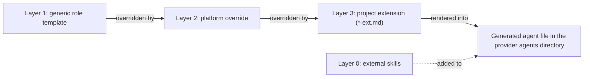
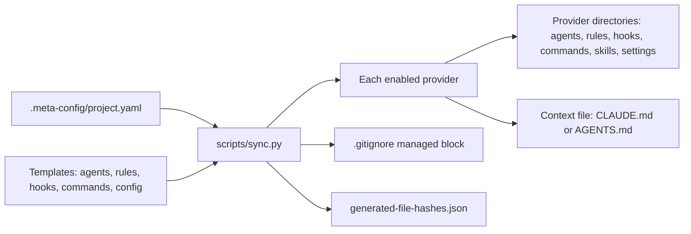
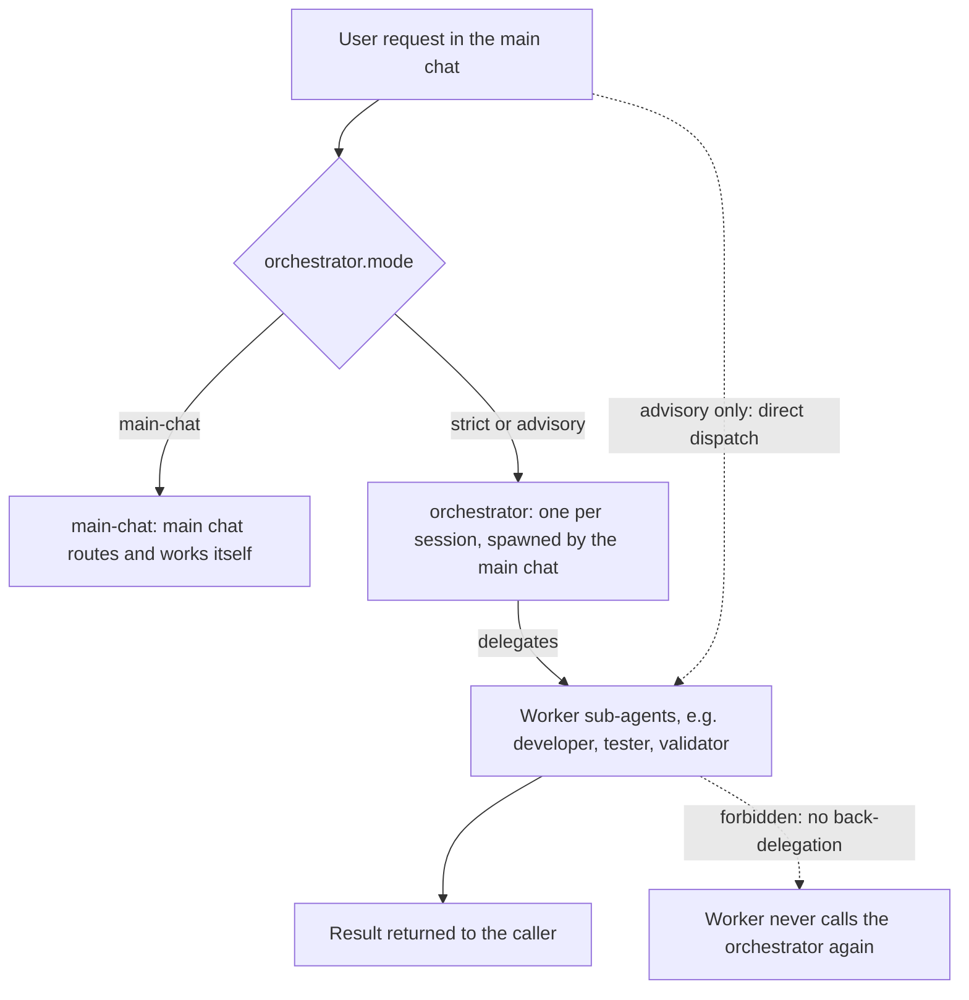
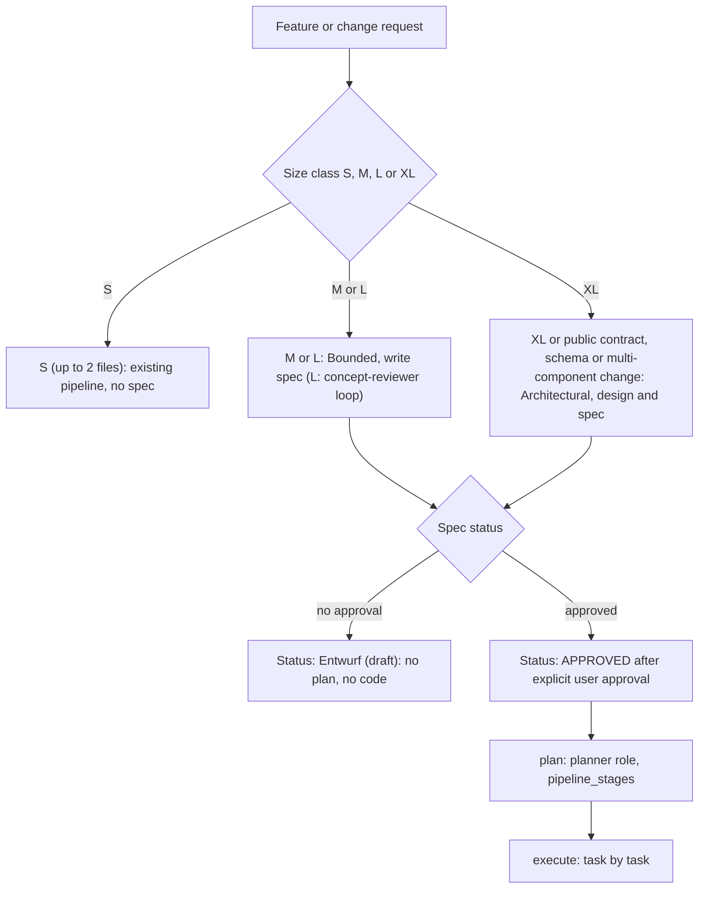

# agent-meta

[](https://github.com/Popoboxxo/agent-meta/releases/tag/v2.0.0-beta.6)
[](CHANGELOG.md)
[](https://repowise.dev/repo/popoboxxo/agent-meta)
[]()
[](LICENSE)

agent-meta is a Git submodule that provides standardized, versioned role templates for Claude-style
coding agents. `scripts/sync.py` renders these templates, together with your project's
configuration, into provider-specific agent, rule, hook and command files for your repository.

> [!WARNING]
> **VibeCoding experiment.** This repository is run intentionally as an LLM-driven development
> experiment. Its purpose is to show benefits and risks of agent-driven development on a real, evolving
> framework. It is a sandbox, not a production-hardened product. Source code changes are meant for
> emergencies only; the preferred workflow is prompt-driven iteration. Limitations are kept visible on purpose.

## Contents

- [Key facts](#key-facts)
- [Quick start](#quick-start)
- [Concepts](#concepts)
- [Configuration](#configuration)
- [Providers](#providers)
- [Agents and platforms](#agents-and-platforms)
- [Skills, tools and MCP servers](#skills-tools-and-mcp-servers)
- [Hooks](#hooks)
- [Workflow controls](#workflow-controls)
- [Admin UI and CLI](#admin-ui-and-cli)
- [Knowledge Engine](#knowledge-engine)
- [Slash commands](#slash-commands)
- [Documentation](#documentation)
- [Upgrading](#upgrading)
- [Development and testing](#development-and-testing)
- [Contributing](#contributing)
- [License](#license)

## Key facts

- **Version:** 2.0.0-beta.6 (see `VERSION`, [CHANGELOG.md](CHANGELOG.md)).
- **Runtime:** Python 3.9+. The only runtime dependency is PyYAML (`requirements.txt`, see
  [ADR 0001](docs/adr/0001-pyyaml-runtime-ausnahme.md)). Everything else is standard library.
  Optional: `questionary` enables arrow-key navigation in `--setup`.
- **Providers:** Claude, Gemini, Opencode, Continue, Copilot, Mammouth, Codex, ZCode, KimiCode.
  Claude and Opencode are exercised day to day; the others generate correctly per `sync.py --validate`
  and the test suite but have not been run in a real project by a maintainer. See [Providers](#providers).
- **Layout:** templates live in `agents/0-external`, `agents/1-generic`, `agents/2-platform`.
  Output is generated, never edited by hand.

## Quick start

Requirements: Git, Python 3.9+, and a project repository.

```bash
# 1. Add the framework to your project
git submodule add https://github.com/Popoboxxo/agent-meta .agent-meta
git submodule update --init --recursive

# 2. Optional: pin a release tag (example)
cd .agent-meta && git checkout v2.0.0-beta.6 && cd ..

# 3. Install the runtime dependency
pip install -r .agent-meta/requirements.txt

# 4. Interactive setup: writes .meta-config/project.yaml, then runs --init
python .agent-meta/scripts/sync.py --setup
```

Non-interactive alternative: `python .agent-meta/scripts/sync.py --init` (default values, then sync).
On Windows, use `py` instead of `python`.

**Expected result:** `.meta-config/project.yaml` exists, and agent files appear in each enabled
provider's agents directory (for Claude: `.claude/agents/`). `sync.log` lists warnings, e.g. missing
variables.

AI assistants integrating the framework into a project should run the steps above, then re-run
`sync.py` after every change to `.meta-config/project.yaml`.

**Next steps after editing the config:**

```bash
python .agent-meta/scripts/sync.py --dry-run   # preview what would change
python .agent-meta/scripts/sync.py             # render and write
python .agent-meta/scripts/sync.py --validate  # check the generated output
```

### Standalone personas (no Python)

For a single chat session without installing anything, use the pre-rendered personas in
[`standalone/`](standalone/README.md). Each file is self-contained and can be pasted as a system prompt
or custom instructions. They have no delegation, DoD gate or A2A protocol; use the full setup for those.

## Concepts

### Layers

Agent and rule sources are merged in four layers. Higher layers override lower ones.

| Layer | Source | Purpose |
|-------|--------|---------|
| 0 — external | `agents/0-external/`, `config/skills-registry.yaml` | Skills cloned from external repositories when enabled |
| 1 — generic | `agents/1-generic/`, `rules/1-generic/`, `hooks/1-generic/` | Provider-agnostic role templates and framework rules |
| 2 — platform | `agents/2-platform/`, `rules/2-platform/`, `platform-configs/` | Platform overrides (see [Platforms](#platform-overrides)) |
| 3 — project | `.claude/3-project/` (extension files, e.g. `*-ext.md`) | Project-owned content; never overwritten by sync |

The diagram shows the precedence chain: a higher layer overrides the layer below it, and the result is
rendered into the generated agent file. Layer 0 skills are added alongside.



Details: [docs/architecture/01-layer-model.md](docs/architecture/01-layer-model.md) and
[docs/api/composition-system.md](docs/api/composition-system.md).

### Placeholders

Templates contain placeholders written as double braces around an UPPER_SNAKE_CASE name. `sync.py`
resolves them at render time. Provider differences (for example how a sub-agent is dispatched) are
handled by provider-abstraction placeholders (`PAL_*`). Reference: [docs/api/pal-variables.md](docs/api/pal-variables.md).
Project-level variables are set under `variables:` in `.meta-config/project.yaml`.

### What sync writes

- Per enabled provider: agents, rules, hooks, commands, settings and one context file (for example `CLAUDE.md` or `AGENTS.md`).
- A managed `.gitignore` block (configurable under `gitignore:`).
- `.meta-config/generated-file-hashes.json`, used to warn (not block) when a generated file was edited by hand.
- Files in `.claude/3-project/` and personal files are not overwritten.



## Context Profiles

`context-profile: full|compact` (default `full`) is a top-level `project.yaml` key selecting the
context-density profile. Per provider: `provider-overrides.<Provider>.context-profile`.

`compact` is **opt-in and unverified**. The role-routing eval that would evidence it has not run,
because its `full` baseline (AC-02) was skipped by the user (0f.3). The planned proof is package 2f,
which needs a separate user approval with a cost estimate first. A sync with `context-profile: compact`
writes the INFO `context-profile.unverified` to `sync.log`. A missing key or `full` keeps every render
byte-identical.

The AC-26 size targets for `compact` are **estimates**, not measurements. Measurements:
`sync.py --context-report --profile compact|both`. Flags and precedence:
[`docs/api/cli-reference.md`](docs/api/cli-reference.md).

## Configuration

Create or edit `.meta-config/project.yaml`. This file belongs to your project; the `.agent-meta/`
submodule must not be edited.

```yaml
ai-providers:
  - Claude
  - Opencode

dod-preset: rapid-prototyping      # see DoD presets below
speech-mode: short                 # see Speech modes below
platforms: []                      # e.g. [hacs]

roles:                             # optional whitelist; omit to generate all roles
  - orchestrator
  - developer
  - tester
  - documenter
  - git

orchestrator:
  mode: main-chat                  # strict | advisory | main-chat
```

Common top-level keys (all verified in `scripts/lib/`):

| Key | Values / type | Notes |
|-----|---------------|-------|
| `ai-providers` | list of provider names | Providers to generate for |
| `roles` | list of role names | Whitelist; omit for all roles |
| `platforms` | list | Activates `agents/2-platform` overrides |
| `dod-preset` | preset name | DoD gate level; see [DoD presets](#dod-presets) |
| `conventions-preset` | `default`, `calver`, `conventional-strict` | Release naming and versioning |
| `rules-preset` | `default`, `minimal`, `silent` | Which rules are active |
| `speech-mode` | mode name | Agent response style; see [Speech modes](#speech-modes) |
| `orchestrator.mode` | `strict`, `advisory`, `main-chat` | Task routing; see [Orchestrator modes](#orchestrator-modes) |
| `orchestrator.native-extensions.whitelist` | list | Native skills/plugins/hooks exempt from the strict gate |
| `auto_commit` | block | Opt-in commit authority; see [Auto-commit](#auto-commit) |
| `knowledge-engine` | block | Opt-in wiki bundle; see [Knowledge Engine](#knowledge-engine) |
| `variables` | map | Project variables substituted into templates |
| `drift-detection`, `context-profile`, `lifecycle-triggers`, `external-tools` | blocks / values | Documented in the annotated example file |

The full annotated example is [`templates/configs/project.yaml.example`](templates/configs/project.yaml.example).
The complete option reference is in [docs/api/cli-reference.md](docs/api/cli-reference.md) and
[docs/guides/setup/config-layout.md](docs/guides/setup/config-layout.md).

### Config ownership

| Location | Owner | Purpose |
|----------|-------|---------|
| `.agent-meta/config/` | agent-meta | Role defaults, providers, presets. Read-only for projects. |
| `.meta-config/project.yaml` | your project | Identity, providers, roles, workflow settings |
| `.claude/platform-config.yaml` | your project | Values for `{{platform.*}}` variables |

## Providers

Status is the maintainer's own assessment, as stated in the project.

| Provider | Status | Context file | Agents directory | PreToolUse hooks |
|----------|--------|--------------|------------------|------------------|
| Claude Code | Tested | `CLAUDE.md` | `.claude/agents/` | yes |
| Opencode | Tested | `AGENTS.md` | `.opencode/agents/` | no |
| Gemini | Experimental | `AGENTS.md` | `.gemini/agents/` | yes |
| Continue | Experimental | `.continue/rules/project-context.md` | `.continue/agents/` | no |
| Copilot | Experimental | `.github/copilot-instructions.md` | `.github/agents/` | no |
| Mammouth Code | Experimental | `AGENTS.md` | `.mammouth/agents/` | yes |
| Codex | Experimental | `AGENTS.md` | `.codex/agents/` | yes |
| ZCode | Experimental | `AGENTS.md` | `.zcode/agents/` | no |
| KimiCode | Experimental | `AGENTS.md` | `.kimi-code/agents/` | no |

Source of truth: [`config/ai-providers.yaml`](config/ai-providers.yaml). Provider notes:
[docs/providers/](docs/providers/).

Hook enforcement applies only where the provider has hook support (`has_hooks`). On other providers,
settings such as `orchestrator.mode` are rules to the model, not enforced restrictions.

Continue and Copilot have no per-agent model tiers; they are managed centrally.

## Agents and platforms

### Role templates

Role templates are in `agents/1-generic/`. Each file has YAML frontmatter (`name`, `version`,
`description`, `tools`) and uses semantic versioning. The full catalogue, with descriptions and
versions, is in [docs/agent-mindmap.md](docs/agent-mindmap.md) and in the files themselves.

Key roles:

| Role | Purpose |
|------|---------|
| `orchestrator` | Routes tasks, decomposes work, delegates to sub-agents |
| `developer` | Feature implementation and bugfixes |
| `tester` | Isolated unit tests (TDD) |
| `code-reviewer` | Code health review: Clean Code, SOLID, blast radius |
| `validator` | DoD gatekeeper: checkboxes, REQ-IDs, commit conventions |
| `documenter` | Internal docs: CODEBASE_OVERVIEW, ARCHITECTURE, README |
| `technical-writer` | External docs for developers and end users |
| `planner` | Turns concepts, REQs or bugs into ordered implementation plans |
| `release` | Versioning, changelogs, release process |
| `git` | All git operations, including push, tag and branch management |
| `agent-meta-manager` | Upgrades, sync and extension management for agent-meta itself |

Specialist, workflow, knowledge and systems-engineering roles are in the same directory. Systems
engineering roles (`se-*`) use the legacy format; see [docs/se-cascade/se-workflow.md](docs/se-cascade/se-workflow.md).

Adding a role: see [Adding a new agent role](#adding-a-new-agent-role).

### Platform overrides

A platform bundles role overrides, rules and variable defaults for one target domain. Activate with
`platforms: [<name>]` in `.meta-config/project.yaml`.

| Platform | Roles with platform overrides |
|----------|-------------------------------|
| `agent-meta` | developer, claude-expert, continue-expert, copilot-expert, gemini-expert, opencode-expert, mammouth-expert |
| `homeassistant` | developer, documenter, log-analyzer |
| `sharkord` | developer, docker, release |
| `hacs` | developer, tester, code-reviewer, devops-engineer, release |

Each platform file either replaces a generic role or extends it through `extends:` and `patches:`.
Platform variables come from `platform-configs/<platform>.defaults.yaml`, overridable in
`.claude/platform-config.yaml`. Required variables with no default produce a `[WARN]` in `sync.log`
until set.

#### HACS example

For developing Home Assistant custom integrations distributed through HACS. Activation:

```yaml
# .meta-config/project.yaml
platforms: [hacs]
```

```yaml
# .claude/platform-config.yaml
platform:
  hacs:
    dev_instance_url: "http://homeassistant.local:8123"
    integration_repo_url: "https://github.com/your-org/your-integration"
    reference_repo_url: "https://github.com/home-assistant/core"
    project_skills: "hacs-integration-development,hacs-integration-review"
```

The HACS preset adds a development workflow, release naming rules (stable tags `vX.Y.Z`, beta tags
`vX.Y.ZbN`) and debugging guidance. Walkthrough: [docs/guides/setup/instantiate-project.md](docs/guides/setup/instantiate-project.md).

### Provider expert roles

`claude-expert`, `gemini-expert`, `opencode-expert`, `mammouth-expert`, `continue-expert` and
`copilot-expert` cover each provider's configuration and best practices.

## Skills, tools and MCP servers

### External skills (layer 0)

External skill repositories are registered in [`config/skills-registry.yaml`](config/skills-registry.yaml).
Entries marked `approved: true` are vetted by the maintainer. A project must still enable a skill in
`.meta-config/project.yaml` before `sync.py` clones it.

```bash
python .agent-meta/scripts/sync.py --add-skill <repo-url> --skill-name <name> --role <role>
```

### Dev-tool integrations

Locally installed CLI tools can contribute rules and hook wrappers through the catalogue in
[`config/plugin-catalog.yaml`](config/plugin-catalog.yaml) (`kind: cli-tool`). Tools never edit generated
files directly. Example, enabled per project:

```yaml
# .meta-config/project.yaml
external-tools:
  graphify:
    enabled: true
```

### MCP servers

Catalogued in [`config/plugin-catalog.yaml`](config/plugin-catalog.yaml). Current entries:

| ID | Kind | Purpose |
|----|------|---------|
| `home-assistant` | MCP server | Read-only Home Assistant data |
| `influxdb` | MCP server | Time-series queries (writes blocked) |
| `viz-logger` | MCP server | Agent event logging |
| `a2a-handoff` | MCP server | A2A handoff validation |
| `honcho` | MCP server | Persistent memory across sessions |
| `reqogniloom` | MCP server | Requirements, architecture, tests, traceability |
| `playwright` | MCP server | Browser automation and accessibility audits |
| `projectatlas` | MCP server | Local repository knowledge graph |
| `headroom` | MCP server | Context-compression layer for tool outputs |
| `graphify` | CLI tool | Architecture and file analysis |

Hard tool prohibitions for MCP servers are listed in `.claude/rules/mcp-guardrails.md` in this repository.

### Native extensions whitelist

Provider-native extensions (skills, plugins, lifecycle hooks) are exempt from the strict orchestrator gate
by default. Restrict or extend the exemption list under `orchestrator.native-extensions`:

```yaml
orchestrator:
  native-extensions:
    enabled: true
    whitelist:
      - home-assistant-mcp
```

## Hooks

Shipped in `hooks/1-generic/`. Whether they are wired depends on the provider's hook support.

| Hook | Purpose |
|------|---------|
| `orchestrator-guard.sh` | Enforces orchestrator-first routing rules (for example: no self-handoff) |
| `dod-push-check.sh` | Blocks a push when DoD conditions are unmet (commit conventions, protected branches) |
| `lifecycle-check.sh` | Detects git events (release tags, merges) and writes `pending-tasks.md` for triggered agents |
| `sync-on-config-change.sh` | Re-runs `sync.py` when `.meta-config/project.yaml` changes |
| `viz-log.sh` | Logs agent events for the dashboard |
| `pre-release-check.sh` | Runs pre-release gates from `release-gates/` (see [docs/RELEASE_GATES.md](docs/RELEASE_GATES.md)) |
| `auto-github-release.sh` | Opt-in: creates a GitHub release after a matching tag push. Never blocks the push. |

The guard hooks are a **convention boundary**, not a security boundary: they guard against accidental
misuse, not deliberate bypass. Known gaps are listed in [`.claude/rules/branch-guard.md`](.claude/rules/branch-guard.md).

## Workflow controls

### Orchestrator modes

| Mode | Behavior | Typical use |
|------|----------|-------------|
| `strict` | Orchestrator required; no direct dispatch | Larger teams, strict quality gates |
| `advisory` | Orchestrator recommended; direct dispatch allowed | Balanced control |
| `main-chat` | No orchestrator sub-agent; the main chat routes and works | Prototyping, single developer |



`strict` routes every task through the orchestrator. `advisory` recommends it but allows direct dispatch.
`main-chat` has no orchestrator sub-agent.

Set `orchestrator.mode` in `.meta-config/project.yaml`. Override per provider with
`orchestrator.provider-overrides.<Provider>.mode`.

### DoD presets

Definition-of-Done gate levels, defined in [`config/dod-presets.yaml`](config/dod-presets.yaml).

| Preset | Intended for |
|--------|--------------|
| `full` | Enterprise or regulated projects (REQ traceability, tests, codebase overview) |
| `standard` | Tests required; no REQs or overview |
| `rapid-prototyping` | Minimal overhead |
| `spec-optional` | Systems-engineering available, not mandatory |
| `spec-driven` | Systems-engineering recommended for complex features |
| `concept-driven` | Spec-first, tests, no REQ formalization |
| `spec-certified` | Regulated environments; all gates on |

```yaml
dod-preset: rapid-prototyping
```

Slash command: `/set-preset`.

### Conventions presets

Release versioning and naming, defined in [`config/conventions-presets.yaml`](config/conventions-presets.yaml).

| Preset | Fits | Versioning |
|--------|------|------------|
| `default` | Libraries and CLIs with downstream consumers | `vMAJOR.MINOR.PATCH` |
| `calver` | Continuously deployed services, no external consumers | `{year}.{month}.{patch}` |
| `conventional-strict` | Packages with a fully automated release flow | Conventional-Commit driven |

Override single fields with a `conventions:` block. Two opt-in extras:
`conventions.release.github_release.enabled: true` (auto GitHub release, default off) and
`conventions.release.custom_checklist` (project-specific pre-release rows).

### Auto-commit

Opt-in commit authority for write-capable roles. Default `off`: every commit goes through the `git` role.

| Mode | Behavior |
|------|----------|
| `off` | Agents never commit (default) |
| `suggest` | Agent proposes a commit message in its report; never runs git |
| `auto` | Agent commits when a selected trigger fires |
| `custom` | A project script decides |

Triggers for `auto`: `task-boundary` (subtask complete and tests green), `per-edit`,
`context-pressure`, `file-count-threshold`, `custom`.

```yaml
auto_commit:
  mode: auto
  triggers: [task-boundary, file-count-threshold]
  file_count_threshold: 5
  secret_scan: true
```

Push, tag and branch changes stay exclusively with the `git` role. Authority is derived from each
role's `tools:` frontmatter; roles without Bash get `delegate` or `notify` behavior instead of direct commits.

### Speech modes

One rule file per mode in [`speech/`](speech/): `full` (default, no rule), `short`, `caveman`, `asozial`,
`childish`, `submissive`, `business`, `linkedin`, `bullshit-bingo`. Set with `speech-mode:`.

### Spec and plan gate

Non-trivial feature and change requests are classified by size before any code is written. Ad-hoc
dispatches and `quick-fix`/`bugfix` have no classify stage, so the gate is rule-based there.



Rule: [`rules/1-generic/spec-plan-workflow.md`](rules/1-generic/spec-plan-workflow.md).

### Quality pipelines and reflection loops

Pipelines (for example `feature-lifecycle`, `bugfix`, `refactor`) and generator/critic
loops are documented in [docs/guides/quality-pipelines.md](docs/guides/quality-pipelines.md) and
[docs/guides/reflection-loops.md](docs/guides/reflection-loops.md). Use `/pipelines` to see which are active.

### Model tiers

Roles are assigned abstract tiers (`nano`, `fast`, `balanced`, `powerful`, `max`, `ultra`). Tiers map to
concrete models per provider and preset in [`config/tier-presets.yaml`](config/tier-presets.yaml).
Presets: `Cheap`, `Normal`, `Advanced`, `Expensive`, `Expensive as Hell`. `ultra` is never a role default;
it is reached only through explicit overrides.

Model registry refresh: `python scripts/sync.py --update-models`.

## Admin UI and CLI

### Admin UI

A local web control panel for project configuration, viz dashboard and plugin status.

```bash
python scripts/sync.py --admin                 # start, default port 7420
python scripts/sync.py --admin --admin-port 8080
```

The Admin UI is also available as the `/admin` slash command. Its views include the orchestrator
settings, DoD overrides, MCP role overrides, plugins and the viz dashboard.
Frontend: [docs/ui/admin-ui.html](docs/ui/admin-ui.html). Backend: `scripts/admin-server.py`
(`--host`, `--port`, `--root`, `--token`).

Remote access beyond localhost requires token authentication:
[docs/howto/admin-ui-remote-access.md](docs/howto/admin-ui-remote-access.md). Admin UI reference:
[docs/api/admin-ui-reference.md](docs/api/admin-ui-reference.md).

### CLI

Full reference: [docs/api/cli-reference.md](docs/api/cli-reference.md). Most used flags:

| Flag | Purpose |
|------|---------|
| `--setup` | Interactive setup wizard, then `--init` |
| `--init` | Create config defaults and sync |
| `--dry-run` | Show what would be written, write nothing |
| `--validate` | Validate generated output |
| `--check` | Read-only artifact-contract check |
| `--doctor` | Installation diagnosis (writes only to the tmp sink) |
| `--audit-config` | Inspect configuration for inconsistencies (`--apply` to fix) |
| `--optimize-config` | Advisory config optimizer (proposals only) |
| `--apply-config-patch <proposal.json> --accept <ID>` | Preview an accepted proposal (`--dry-run`); apply with `--preview <preview.json>` after confirming it |
| `--context-report` | Context size report (`--profile full\|compact\|both`) |
| `--create-ext <role>` | Create a project extension file for a role |
| `--create-rule`, `--create-hook`, `--create-command` | Scaffold project-specific artifacts |
| `--add-skill <url>` | Register an external skill |
| `--update-models` | Refresh the model registry |
| `--backup`, `--restore`, `--list-backups` | Back up and restore generated provider state |
| `--admin`, `--admin-port` | Start the Admin UI |
| `--viz`, `--viz-mode` | Viz dashboard and event logging |
| `--validate-spec-plan` | Check spec and plan artifacts |

Optimizer exit codes: 0 on success (a preview counts), 1 on a rejection or version/stale/preview mismatch with nothing written, 2 on usage errors or tmp-sink/render/write errors. Details: [CLI Reference](docs/api/cli-reference.md).

Exit codes and value formats are documented in [docs/api/cli-reference.md](docs/api/cli-reference.md).

## Knowledge Engine

An opt-in, OKF-compliant wiki bundle maintained by agents. Enable with `knowledge-engine.enabled: true`.

- `knowledge/schema.md` — conventions and concept types
- `knowledge/sources/` — immutable raw sources
- `knowledge/wiki/` — LLM-maintained pages, with `index.md` and `log.md`

Roles: `knowledge-curator` (schema), `knowledge-ingestor` (ingest), `knowledge-querier` (query),
`knowledge-linter` (health checks), `knowledge-indexer`, `knowledge-gardener` (maintenance),
`knowledge-migrator` (migration into OKF).

## Slash commands

22 commands in `commands/1-generic/`. Descriptions: [docs/api/slash-commands.md](docs/api/slash-commands.md).

`/add-mcp-server`, `/add-project-role`, `/add-provider`, `/admin`, `/analysis`, `/analyze-logs`,
`/checkpoint`, `/commit`, `/consistency-check`, `/diagnose`, `/doc-now`, `/feedback`, `/merge`,
`/open-docs`, `/pipelines`, `/report-bug`, `/set-preset`, `/test-orchestration`, `/update-extensions`,
`/update-meta`, `/upgrade-meta`, `/what-is`

## Documentation

| Topic | Document |
|-------|----------|
| Project setup and instantiation | [docs/guides/setup/instantiate-project.md](docs/guides/setup/instantiate-project.md) |
| Configuration layout | [docs/guides/setup/config-layout.md](docs/guides/setup/config-layout.md) |
| CLI reference | [docs/api/cli-reference.md](docs/api/cli-reference.md) |
| Slash commands | [docs/api/slash-commands.md](docs/api/slash-commands.md) |
| Composition system (overrides, patches) | [docs/api/composition-system.md](docs/api/composition-system.md) |
| Placeholders (PAL) | [docs/api/pal-variables.md](docs/api/pal-variables.md) |
| Handoff protocol (A2A) | [docs/concepts/a2a-handoff-protocol.md](docs/concepts/a2a-handoff-protocol.md) |
| Layer model | [docs/architecture/01-layer-model.md](docs/architecture/01-layer-model.md) |
| Release gates | [docs/RELEASE_GATES.md](docs/RELEASE_GATES.md) |
| MCP setup | [docs/guides/mcp-setup.md](docs/guides/mcp-setup.md) |
| Feature guides | [docs/guides/features/](docs/guides/features/) |
| Provider notes | [docs/providers/](docs/providers/) |
| Systems engineering cascade | [docs/se-cascade/se-workflow.md](docs/se-cascade/se-workflow.md) |
| Agent graph and mindmap | [docs/ui/agent-graph.html](docs/ui/agent-graph.html), [docs/agent-mindmap.md](docs/agent-mindmap.md) |
| Viz API and event schema | [docs/api/viz-api.md](docs/api/viz-api.md), [docs/api/viz-event-schema.md](docs/api/viz-event-schema.md) |
| Architecture decisions | [docs/adr/](docs/adr/) |
| Standalone personas | [standalone/README.md](standalone/README.md) |
| Changelog | [CHANGELOG.md](CHANGELOG.md) |

## Upgrading

```bash
cd .agent-meta
git fetch --tags
git checkout <tag>        # e.g. v2.0.0-beta.6
cd ..
python .agent-meta/scripts/sync.py --dry-run   # review the changes
python .agent-meta/scripts/sync.py             # apply
```

Read the CHANGELOG entry for the target version first. Agent files under `.claude/agents/` (and
other provider agent directories) are regenerated on every sync. Files under `.claude/3-project/` are
never overwritten. If a sync reports a missing variable, add it to `variables:` and sync again.

Commit the regenerated output together with the submodule pointer and `.meta-config/project.yaml`.

## Development and testing

```bash
python3 scripts/sync.py --validate                 # validation of the framework itself
python3 scripts/consistency-check.py               # template and cross-reference checks
python3 scripts/sync.py --dry-run                  # render without writing
tests/scenarios/run.sh                             # scenario catalog (see tests/scenarios/registry.md)
pip install -r tests/requirements.txt && pytest    # unit and integration tests
```

- Test dependencies live in `tests/requirements.txt`; they are not runtime dependencies.
- Scenario runs use a fresh temp directory each and never touch this repository.
- CI workflows: `.github/workflows/validate.yml` (sync and validation, Python 3.11) and
  `.github/workflows/orchestration-test.yml` (tests on Python 3.9 and 3.12).

## Contributing

### Branches

Do not commit template, rule, script or sync changes directly to `main`. Use a branch with prefix
`feat/`, `fix/`, `refactor/`, `docs/` or `chore/`, then open a pull request.

### Development workflow

1. Create a branch.
2. Edit templates in `agents/1-generic/` (or `agents/2-platform/`), rules, hooks or `config/`.
3. Bump the template `version` in the frontmatter (semver).
4. Run `python3 scripts/consistency-check.py` and `python3 scripts/sync.py --dry-run`.
5. For a new feature or config option, add a scenario to `tests/scenarios/registry.md`.
6. Commit using Conventional Commits; open a pull request.

Non-trivial changes go through the spec and plan gate (`Status: APPROVED`); see
[`rules/1-generic/spec-plan-workflow.md`](rules/1-generic/spec-plan-workflow.md).

### Commit messages

```
<type>: <description>            # without requirement traceability
<type>(REQ-xxx): <description>   # with requirement traceability
```

Types: `feat`, `fix`, `refactor`, `test`, `chore`, `docs`, `ci`. Description in English, imperative, max 72 characters.

### Conventions

- Python: standard library only, plus PyYAML (see ADR 0001). PEP 8, snake_case.
- Agent templates: YAML frontmatter with semantic versions.
- Generated output (`.claude/agents/`, `.opencode/agents/`, and so on) is never edited by hand.
- Provider differences are expressed through config keys and capability flags, not provider-name branches.

### Adding a new agent role

1. Create `agents/1-generic/<role>.md` with frontmatter:

   ```yaml
   ---
   name: role-name
   version: 1.0.0
   description: What this agent does
   hint: Short hint for /what-is
   tools: [tool1, tool2]
   ---
   ```

2. Add an entry to `config/role-defaults.yaml` (tier, memory, permission mode, routing).
3. Update the agent table in [docs/guides/setup/instantiate-project.md](docs/guides/setup/instantiate-project.md).

Provider agents, context files and visualization are generated by `sync.py`.

## License

MIT. See [LICENSE](LICENSE).
