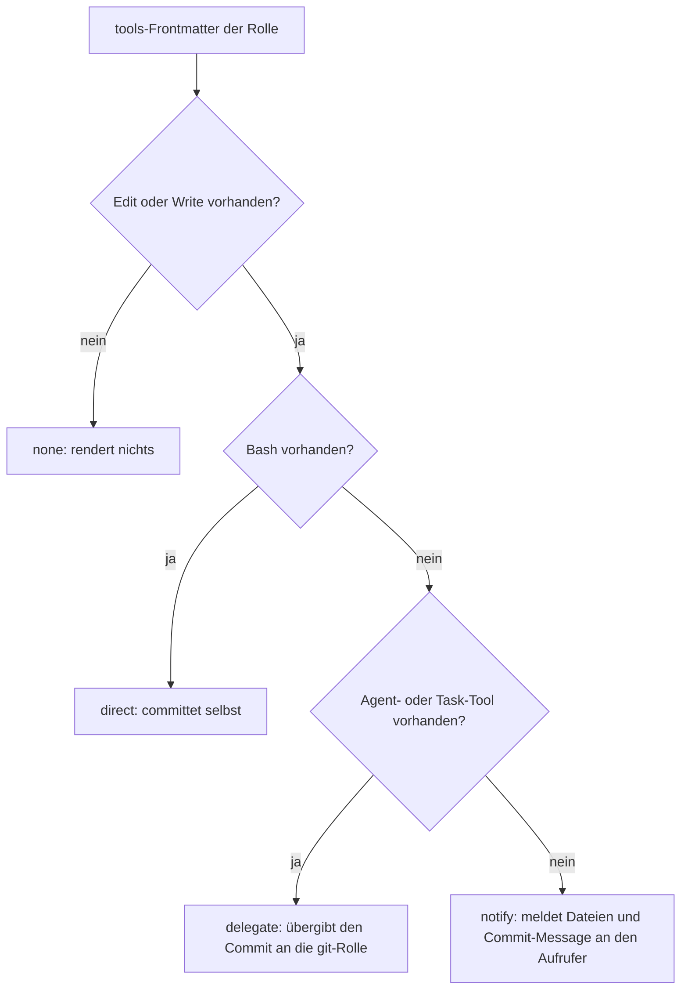

# Framework-Referenz

> Aus dem README ausgelagerte Referenzabschnitte (Stand 2.0.0-beta.6). Quelle der Wahrheit bleibt der Code
> (`agents/1-generic/*.md`-Frontmatter, `config/role-defaults.yaml`, `scripts/lib/`). Versionen und
> Tiers im Roster driften mit jedem Template-Bump — bei Abweichung gilt der Code.
>
> Verwandte Dokumente: [Quality Pipelines](quality-pipelines.md), [Reflection-Loops](reflection-loops.md),
> [Agenten-Mindmap](../agent-mindmap.md), [SE-Kaskade](../se-cascade/se-workflow.md),
> [.gitignore-Konfiguration](features/sync-concept.md#gitignore-konfiguration).

## Inhalt

1. Agenten-Roster
2. Verzeichnisstruktur
3. Orchestrator-Status und Progress-Snapshot
4. Commit-Authority nach Capability-Klasse
5. Synchronisations- und SE-Variablen
6. README-Struktur-Standard (`readme:`)

---

## 1. Agenten-Roster

Tier = `model` aus `config/role-defaults.yaml`. Die Provider-Experten `claude-`, `gemini-`, `opencode-`,
`continue-` und `copilot-expert` teilen sich das Template `agents/1-generic/provider-expert.md`
(eine Version); `mammouth-expert` hat eine eigene Datei. Beschreibung = `short_desc`/`description` der Rolle.

### Generische Agenten (88)

| Agent | Tier | Version | Beschreibung |
|-------|------|---------|--------------|
| **accessibility-specialist** | balanced | 0.6.1 | WCAG 2.1/2.2 Compliance-Audit, ARIA-Checks, Keyboard-Navigation, Screenreader... |
| **agent-meta-manager** | fast | 1.25.0 | agent-meta verwalten: Upgrade, Sync, Feedback, projektspezifische Agenten anl... |
| **agent-meta-scout** | fast | 1.5.2 | Claude-Ökosystem scouten: neue Skills, Rollen, Rules und Patterns entdecken |
| **ai-governance-engineer** | powerful | 1.0.1 | Modellrisiko-Governance (Risikoklassifikation, Model Card, Bias, EU AI Act/NIST RMF, Decision Records) |
| **ai-observability-engineer** | balanced | 1.0.1 | Agenten-spezifische SLIs (Task Success, Reasoning Quality, Approval Rate, Kosten/Drift) |
| **ai-security-guardian** | powerful | 1.4.1 | KI-spezifische Sicherheitsrisiken: halluzinierte Deps, fabrizierte IAM, unsichere Defaults |
| **api-specialist** | balanced | 1.7.0 | OpenAPI/Contract-First API Design, Schnittstellen-Spezifikationen. |
| **app-lifecycle-governor** | balanced | 1.4.1 | App-Lifecycle-Governance: Ownership, SLA, Data-Classification, Deprecation |
| **backend-reviewer** | balanced | 1.4.0 | Backend-Domain-Review: API-Contracts, Silent Failures, Concurrency, Middleware-Ketten. |
| **bug-feature-analyzer** | fast | 1.5.1 | Issue-Triage: Eingehende Bug-Meldungen und Feature-Requests analysieren und k... |
| **chaos-engineer** | balanced | 1.0.2 | Failure injection with hypothesis, steady-state and kill switch — never production by default |
| **code-reviewer** | powerful | 1.9.2 | Clean Code Gatekeeper: Blast-Radius-Analyse, SOLID/DRY Prüfung, Code-Qualität... |
| **concept-architect** | powerful | 1.4.1 | Systemdesign für komplexe Änderungen: Komponenten, Schnittstellen, Trade-offs |
| **concept-reviewer** | powerful | 1.9.2 | Konzept-Critic: reviewt Design-Docs und Konzepte auf Vollständigkeit, Logik, ... |
| **concept-specifier** | balanced | 1.4.2 | Technische Spezifikationen aus Anforderungen und Codebase-Kontext — implementiert nicht |
| **context-engineer** | balanced | 1.0.0 | Context budget: instruction hierarchy, compaction, what enters the window and what does not |
| **control-framework-assessor** | powerful | 1.2.0 | Assesses governance, risk and control processes against a named framework (COSO... |
| **copyeditor** | balanced | 0.5.1 | Lektorat: Stil, Satzbau, Wortwiederholungen, roter Faden, inhaltliche Konsistenz. |
| **data-engineer** | balanced | 0.6.1 | ETL/ELT-Pipelines, Schema-Migration (Datenebene), Data-Quality-Checks, Lineag... |
| **database-engineer** | powerful | 1.4.1 | Relationales Schema-Design, Datenbank-Migrationen, Query-Optimierung und Inde... |
| **database-reviewer** | powerful | 1.5.0 | Datenbank-Domain-Review: Migration-Safety, N+1, Injection-Vektoren, Indexing, Transaktionen. |
| **dependency-auditor** | balanced | 1.7.1 | Supply-Chain-Hygiene: SBOM-Analyse, Lizenz-Kompatibilität, Version-Drift und ... |
| **design-system-architect** | balanced | 0.6.1 | Design-System-Schema → echte Token-Artefakte, Farbharmonie, Variant-Contracts. |
| **developer** | balanced | 4.8.1 | Feature-Implementierung und Bugfixes |
| **devops-engineer** | fast | 1.7.1 | CI/CD, Infrastructure as Code, Kubernetes, Observability. |
| **docker** | fast | 1.9.1 | Dev-Stack verwalten, Test-Stack starten, Binary-Management, Dockerfiles erste... |
| **documenter** | fast | 1.11.1 | CODEBASE_OVERVIEW, ARCHITECTURE, README, Erkenntnisse pflegen |
| **e2e-tester** | balanced | 1.6.1 | E2E-Tests, visuelle Regression und Accessibility-Audits via Playwright |
| **effort-estimator** | fast | 1.4.0 | Schätzt Aufwände für Entwicklungsaufgaben basierend auf Task-Typ und LLM-Kali... |
| **explorer** | fast | 1.4.0 | Read-only Codebase-Recherche, Dependency- und Impact-Mapping, Datei- und Symb... |
| **export-manager** | fast | 1.6.0 | Target-agnostischer Output-Router: Markdown, Confluence, Jira-Xray, Notion. |
| **feedback** | nano | 1.8.1 | Projekt-Feedback standardisieren: Bugs, Features, Verbesserungen als GitHub I... |
| **fraud-risk-assessor** | powerful | 1.1.0 | Assesses occupational fraud risk and appraises the anti-fraud program across det... |
| **frontend-component-engineer** | balanced | 0.6.1 | Screen-Spec + Token-Contract → produktionsreife UI-Komponenten. |
| **frontend-reviewer** | balanced | 1.4.0 | Frontend-Domain-Review: Komponenten, State, SSR/Hydration, Browser-APIs, Render-Performance. |
| **git** | nano | 2.1.0 | Commits, Branches, Tags, Push/Pull und alle Git-Operationen |
| **ideation** | balanced | 1.15.0 | Neue Ideen explorieren, Vision schärfen, Übergabe an requirements |
| **incident-responder** | balanced | 1.6.1 | Live-Incident-Koordination: korreliert Logs und Metriken, führt Runbook-Schri... |
| **intern-developer** | nano | 1.2.0 | [EASTER EGG / GAG] Der übereifrige Praktikant |
| **junior-developer** | fast | 1.8.2 | Triviale Code-Änderungen (≤2 Dateien, kein Architektur-Impact) |
| **knowledge-curator** | balanced | 1.4.2 | Strategische Knowledge-Engine-Steuerung: Schema-Evolution, Wiki-Strukturierun... |
| **knowledge-gardener** | nano | 1.4.1 | Kleinteilige Wiki-Pflege: Links reparieren, Tags harmonisieren, Frontmatter e... |
| **knowledge-indexer** | nano | 1.4.1 | Pflegt index.md (Content-Katalog, OKF §6) und log.md (Chronologisches Event-L... |
| **knowledge-ingestor** | balanced | 1.6.2 | Sources einlesen, Key Information extrahieren, Wiki-Seiten erstellen/ aktuali... |
| **knowledge-linter** | fast | 1.3.1 | Wiki-Gesundheitscheck: Widersprüche, Orphans, veraltete Claims, kaputte Links... |
| **knowledge-migrator** | balanced | 1.5.2 | Vorhandene Projektinhalte aufräumen und OKF-konform ins Knowledge Wiki migrieren |
| **knowledge-querier** | fast | 1.5.2 | Fragen gegen das Knowledge Wiki beantworten |
| **llm-evaluator** | powerful | 1.0.1 | Misst Modell-/Agenten-Output gegen Golden Dataset (Rubriken, LLM-as-judge, Regressions-Gates) |
| **log-analyzer** | fast | 1.6.1 | System- und Applikations-Logs analysieren: Frequency-Clustering, Severity-Kla... |
| **mammouth-expert** | balanced | 2.0.0 | Absoluter Analyse-Experte für die Plattform Mammouth Code: Funktionsweise, Ko... |
| **memory-architect** | balanced | 1.0.0 | Agent memory architecture: consolidation, retrieval quality, forgetting, write/read separation |
| **meta-doctor** | fast | 1.0.0 | Diagnoses the agent-meta installation (reports only to the tmp-sink) |
| **meta-feedback** | fast | 2.6.1 | Verbesserungsvorschläge für agent-meta als GitHub Issues einreichen |
| **meta-optimizer** | balanced | 1.0.0 | Proposes compact project-config variants (proposal only) |
| **openscad-developer** | balanced | 1.6.0 | Parametrische 3D-Modelle in OpenSCAD generieren, Render-Inspect-Refine via MC... |
| **orchestrator** | balanced | 8.8.1 | Einstiegspunkt für alle Entwicklungsaufgaben |
| **performance-optimizer** | powerful | 1.8.0 | Big-O Bottleneck-Identifikation und datengetriebene Performance-Optimierung. |
| **planner** | balanced | 1.6.0 | Umsetzungsplanung |
| **principal-developer** | max | 1.6.0 | Last-Resort-Eskalationsstufe |
| **privacy-compliance-officer** | balanced | 1.0.0 | GDPR and AI-Act obligations: legal basis, minimisation, retention, transparency, oversight |
| **product-manager** | balanced | 0.4.1 | Strategisches Produkt-Management: Backlog, User-Stories, Sprint-Planung, Prio... |
| **prompt-engineer** | balanced | 1.11.0 | Der ultimative Experte für Prompt-Engineering |
| **prompt-governor** | balanced | 1.5.2 | Prompt-Governance: PromptBOM, Audit-Trail, Provenance, Banned-Patterns |
| **proofreader** | balanced | 0.5.1 | Korrektorat: reine Fehlerkorrektur — Rechtschreibung, Grammatik, Zeichensetzung. |
| **claude-expert** | powerful | 1.5.1 | Absoluter Analyse-Experte für die Plattform Claude Code: Funktionsweise, Konf... |
| **gemini-expert** | balanced | 1.5.1 | Absoluter Analyse-Experte für die Plattform Gemini (Antigravity): Funktionswe... |
| **opencode-expert** | balanced | 1.5.1 | Absoluter Analyse-Experte für die Plattform Opencode: Funktionsweise, Konfigu... |
| **continue-expert** | powerful | 1.5.1 | Absoluter Analyse-Experte für die Plattform Continue: Funktionsweise, Konfigu... |
| **copilot-expert** | powerful | 1.5.1 | Absoluter Analyse-Experte für die Plattform GitHub Copilot: Funktionsweise, K... |
| **rag-engineer** | balanced | 1.0.1 | RAG/Retrieval-Pipelines (Chunking, Embeddings, hybride Suche, Reranking, Retrieval-Eval) |
| **red-team-agent** | balanced | 1.0.0 | Adversarial prompt red-teaming against own systems: injection, jailbreak, tool misuse |
| **refactoring-specialist** | balanced | 0.5.1 | Systematische großflächige Code-Transformation mit Sicherheitsnetz: Strangler... |
| **release** | fast | 1.12.2 | Versioning, Changelog, Build-Artifact, GitHub Release erstellen |
| **reproducible-builds-engineer** | balanced | 1.0.2 | Build determinism and provenance: double-build byte compare, SBOM, non-determinism sources |
| **requirements** | fast | 1.9.1 | Anforderungen aufnehmen, REQ-IDs vergeben, REQUIREMENTS.md pflegen |
| **risk-based-audit-planner** | balanced | 1.1.0 | Risk-based audit scoping: auditable area to objectives, risks, key controls and... |
| **secrets-manager** | balanced | 1.0.0 | Secret lifecycle: creation, storage, rotation, revocation, leak handling — references only |
| **security-auditor** | powerful | 2.8.0 | Sicherheits-Audit: OWASP, Secrets, Dependencies, Supply-Chain |
| **senior-developer** | powerful | 1.10.0 | Komplexe Features, Architektur-Entscheidungen, schwierige Bugs, Cross-Cutting... |
| **sre-engineer** | balanced | 0.7.1 | Proaktive Reliability-Disziplin: SLI/SLO-Definition, Error-Budgets, Capacity-... |
| **technical-writer** | fast | 0.4.1 | Externe entwickler- und nutzergerichtete Doku: API-Referenzen, Getting-Starte... |
| **template-auditor** | fast | 1.0.0 | Read-only Audit der Agenten-Definitionen — Findings statt Fixes |
| **test-executor** | nano | 1.2.2 | Bestehende Test-Suiten ausführen — kein Test-Design, kein Code-Schreiben |
| **tester** | fast | 2.8.0 | TDD, Test-Suite ausführen, Testabdeckung sichern |
| **ui-reviewer** | balanced | 1.4.0 | UI-Review: Design-Token-Conformance, Layout-Konsistenz, Interaction-States, i18n-Readiness. |
| **ui-ux-designer** | balanced | 1.6.0 | UI-Spezifikationen, Mockups und Design-Systeme erstellen. |
| **ux-researcher** | balanced | 1.0.1 | User research discipline: past behaviour over opinion, sample and bias stated, findings as hypotheses |
| **validator** | balanced | 4.7.2 | Code gegen REQs prüfen, DoD-Checkliste, Traceability-Audit |

### Systems-Engineering-Kaskade (Legacy SE-Modus) (14)

| Agent | Tier | Version | Beschreibung |
|-------|------|---------|--------------|
| **se-architect** | powerful | 2.2.2 | Zerlegt Blackboxes in Whiteboxes nach strengen Architekturgesetzen (CQRS, Ort... |
| **se-component-requirements** | balanced | 1.2.2 | L3-Component-Requirements pro Leaf-Component (Issue |
| **se-critic** | powerful | 2.2.2 | Prüft Architekturentscheidungen iterativ auf Vollständigkeit, Konsistenz und ... |
| **se-developer** | balanced | 1.8.2 | Standard SE-Leaf-Implementierung (2-4 Interfaces) mit strikter Interface-Disz... |
| **se-integration-and-test-manager** | balanced | 2.2.4 | V&V-Orchestrator: Bestimmt Integrationsstrategie und koordiniert Test-Ebenen. |
| **se-interface-mgr** | fast | 1.11.3 | Verwaltet und validiert alle Schnittstellenverträge domänenübergreifend. |
| **se-junior-developer** | fast | 1.8.2 | Triviale SE-Leaf-Implementierung (0-1 Interfaces, kein cross-cutting) |
| **se-requirements** | balanced | 2.2.3 | Nimmt Stakeholder-Bedürfnisse auf und erstellt das formale L1-Blackbox-Requir... |
| **se-senior-developer** | powerful | 1.8.1 | Komplexe SE-Leaf-Implementierung (5+ Interfaces, cross-cutting, boundary-leve... |
| **se-termination** | fast | 1.12.3 | Entscheidet deterministisch, ob der L3-Component-Leaf-Node erreicht wurde. |
| **se-test-engineer** | balanced | 1.7.1 | Entwickelt MBSE-Testmodelle und entwirft Integrationstests für den rechten V-... |
| **se-testreviewer** | powerful | 1.6.1 | Auditiert Teststrategien auf Edge-Cases, Boundary Values, Äquivalenzklassen u... |
| **se-validator** | powerful | 1.7.4 | L1 System-Validierung: End-to-End User Journeys gegen Stakeholder-Bedürfnisse. |
| **se-verifier** | balanced | 1.8.2 | Multi-Level Verification (L1-Ln): Prüft integrierte Systeme gegen Architektur... |

Hinweise:

- SE-Rollen liegen im Legacy-Format; die Hauptrollen nutzen Context Compaction V2 (Single-Tree-XML).
- Das Knowledge-Engine-Feature (Scaffolding `knowledge/`, Domain-Presets, `knowledge.py`-Bundle-Manager)
  ist in `docs/concepts/` und im Abschnitt „Knowledge Engine" der `CODEBASE_OVERVIEW.md` beschrieben.
- Die [Agenten-Mindmap](../agent-mindmap.md) wird automatisch generiert und zeigt Delegationsbeziehungen, kein Roster.

## 2. Verzeichnisstruktur

```
agents/
  0-external/                # Wrapper für externe Skills
  1-generic/                 # Provider-agnostische Templates (inkl. SE-Rollen; _*.md sind Referenzdateien)
  2-platform/                # Platform-Overrides (Full-Replacement oder Composition)
config/                      # Framework-Config (role-defaults, dod-presets, tier-presets, ai-providers,
                             #   plugin-catalog, skills-registry, model-curation, known-issues, ...)
  generated/                 # Generierte Caches (z.B. model-registry.json)
commands/1-generic/          # Slash-Command-Definitionen
hooks/1-generic/             # Hook-Skripte (+ lib/, release-gates/)
rules/                       # Rule-Snippets (1-generic/, 2-platform/), in Provider-Kontextdateien injiziert
scripts/
  sync.py                    # Haupt-CLI (nur argparse + main)
  admin-server.py            # Admin-UI-Backend
  viz-logger.py, viz-server.py, viz-report.py   # Event-Logging / Live-Dashboard / Session-Report
  consistency-check.py       # Template-Validierung
  run-cascade.py             # SE-Cascade-Runner
  lib/                       # Logik-Module (je <= 600 Zeilen)
snippets/                    # developer/, tester/, orchestrator/
external/                    # Geklonte Skill-Repos (gitignored)
schemas/                     # A2A-Handoff-JSON-Schemas
speech/                      # Speech-Mode-Rules
templates/                   # Geteilte Template-Fragmente und Config-Vorlagen (templates/configs/)
platform-configs/            # Platform-Variablen-Defaults
standalone/                  # Standalone-Personas (ohne Python nutzbar)
knowledge/                   # Knowledge-Engine-Bundle (wenn aktiviert)
docs/                        # architecture/, concepts/, providers/, guides/, api/, se-cascade/, ...
tests/                       # pytest-Suite; tests/scenarios/ = persistierter project.yaml-Szenario-Katalog
VERSION, CHANGELOG.md, README.md
```

## 3. Orchestrator-Status und Progress-Snapshot

**Status-Tabelle (Issue #678):** Nach jedem Abschluss eines FANOUT/PARALLEL_GROUP-Batch-Mitglieds und
spätestens an jedem BARRIER-Punkt gibt der Orchestrator eine kompakte Tabelle aus (nicht erst am Pipeline-Ende):

| Agent | Task | Status |
|-------|------|--------|
| `<agent>` | `<Ein-Satz-Task>` | `pending` \| `in_progress` \| `done` \| `failed` |

Einzige Quelle ist `snippets/orchestrator/status-table.md`, eingebunden über den Platzhalter
`STATUS_TABLE_BLOCK` (Doppel-Klammer-Syntax) in `rules/1-generic/use-orchestrator.md` (Main-Chat-Modus) und
`agents/1-generic/orchestrator.md` (dedizierter Subagent) — eine Definition, kein Drift. Sie ergänzt die
BARRIER-Zusammenfassung, ersetzt sie nicht.

**Non-git Progress-Snapshot (Issue #682 §6):** `CheckpointStore.save_checkpoint()` (`scripts/lib/checkpoint.py`)
überschreibt zusätzlich `current.md` im Progress-Verzeichnis mit einem lesbaren, nicht historisierten
`Agent | Task | Status`-Snapshot. Default-Pfad `.meta-viz/progress/current.md`, konfigurierbar über den
`progress:`-Block (`dir`, `checkpoint-dir`) in `.meta-config/project.yaml`
(`scripts/lib/progress_paths.py`). Design: `docs/superpowers/specs/2026-09-10-live-progress-channel-design.md`.

## 4. Commit-Authority nach Capability-Klasse

Die Commit-Berechtigung (`auto_commit`, Issue #694) wird aus dem `tools:`-Frontmatter jeder Rolle abgeleitet
(`role_commit_authority()` in `scripts/lib/auto_commit.py`), nicht aus einer Liste:

| Klasse | Kriterium | Verhalten |
|--------|-----------|-----------|
| `direct` | Bash und (Edit und/oder Write) | committet selbst |
| `delegate` | Edit/Write, kein Bash, aber Agent/Task-Tool | übergibt den Commit an die `git`-Rolle |
| `notify` | Edit/Write, kein Bash, kein Spawn-Tool | meldet geänderte Dateien + fertige Conventional-Commit-Message an den Aufrufer |
| `none` | sonst | rendert nichts |

Die Entscheidung folgt der Logik in `role_commit_authority()` (`scripts/lib/auto_commit.py`). `*` im `tools:`-Frontmatter zählt als Spawn-Tool:



Die Anforderung `secret_scan` wird an jede schreibfähige Authority weitergereicht (`direct` scannt selbst,
`delegate` verlangt den Scan beim Committenden, `notify` beim Aufrufer; `secret_scan: false` entfernt die
Anforderung). Die Hook-Allowlist `eligible_roles` bleibt **direct-only**. Push, Tag und Branch-Management
bleiben ausschließlich Aufgabe der `git`-Rolle; das Destructive-Gate (Issue #516) bleibt unberührt.

## 5. Synchronisations- und SE-Variablen

Projektvariablen stehen in `.meta-config/project.yaml` unter `variables:`.

- `WEB_PROJECT_ENABLED` wird **nicht mehr manuell gesetzt**: `scripts/lib/config.py` leitet es aus der Rollenaktivierung
  ab (`true`, wenn `e2e-tester` aktiv ist). Es schaltet Browser-Verifikation und Web-Vitals-Blöcke in
  `developer`, `senior-developer` und `performance-optimizer`.
- SE-Variablen (Defaults aus `se_variables` in `config/role-defaults.yaml`, im Projekt überschreibbar):

| Variable | Default | Bedeutung |
|----------|---------|-----------|
| `SE_BASE_DIR` | `SE` | Ausgabeverzeichnis (auch über `se_output.base_dir`) |
| `SE_MIN_DEPTH` / `SE_MAX_DEPTH` | 2 / 6 | Tiefenbereich der Dekomposition |
| `SE_MAX_CRITIC_ITERATIONS` | 3 | Max. Architektur-Critique-Runden |
| `SE_MAX_PARALLEL_CELLS` | 4 | Max. parallele Komponenten je Ebene |
| `SE_MAX_CELLS` | 20 | Max. Komponenten gesamt |
| `cost_limit_eur` | 5 | Kosten-Obergrenze |

Weitere SE-Details: [SE-Workflow](../se-cascade/se-workflow.md), PAL-Variablen: [pal-variables](../api/pal-variables.md).

## 6. README-Struktur-Standard (`readme:`)

Der `documenter` pflegt die `README.md` eines Zielprojekts nach demselben additiven Managed-Block-Prinzip wie
`.gitignore` (Issue #682 §3): fehlende Pflichtabschnitte werden ergänzt, handgeschriebene Prosa wird nie
pauschal überschrieben. Konfiguration in `.meta-config/project.yaml`:

```yaml
readme:
  badges: [version, stack, license]   # license nur bei vorhandener LICENSE-Datei; ci opt-in (nur bei erkennbarer CI-Config); agent-meta opt-in (AGENT_META_VERSION, sonst "unknown")
  warnings: false                     # true rendert einen [!WARNING]-Callout, nie erzwungen
  sections: [description, badges, setup, structure]
```

Die Werte landen als Variablen `README_BADGES`, `README_WARNINGS_ENABLED`, `README_SECTIONS` im Documenter.
Referenzgerüst: `templates/configs/README-template.md` (Strukturleitfaden, kein Byte-genaues Template).
Siehe auch `docs/concepts/agent-meta-version-badge.md`.
