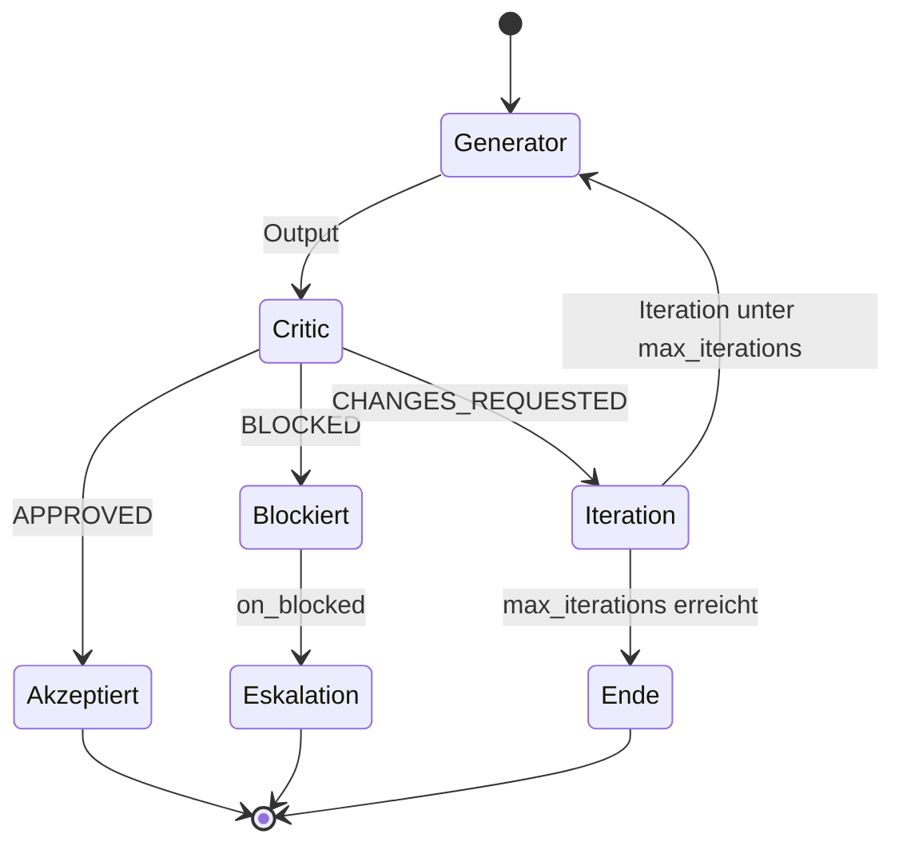

# Reflection-Loops — Generische Iterative Verbesserung

## Konzept

Ein Reflection-Loop besteht aus zwei Rollen:
- **Generator**: Erzeugt Output (Code, Design, Tests, Anforderungen)
- **Critic**: Bewertet den Output und gibt Korrekturhinweise

Der Loop wiederholt sich bis:
- Critic den Output akzeptiert (APPROVE)
- Maximale Iterationszahl erreicht ist
- Loop als "blocked" eskaliert wird

Ablauf eines Pairs. Die Verdicts entsprechen dem generischen Critic (`code-reviewer`: `APPROVED`, `CHANGES_REQUESTED`, `BLOCKED`):



## Konfiguration

### Zentrale Definition: `config/role-defaults.yaml`

```yaml
reflection_pairs:
  - id: dev-review-loop
    generator: developer
    critic: code-reviewer
    max_iterations: 3
    on_blocked: escalate_to_orchestrator
```

### Projekt-Overrides: `.meta-config/project.yaml`

```yaml
reflection-pairs:
  overrides:
    dev-review-loop:
      max_iterations: 5  # Projekt-spezifische Anpassung
```

## Verfügbare Pairs (8)

Quelle: `reflection_pairs` in `config/role-defaults.yaml`. `on_blocked` leer = Default-Eskalation.

| Pair-ID | Generator | Critic | Max Iterationen | on_blocked |
|---------|-----------|--------|-----------------|------------|
| `dev-review-loop` | developer | code-reviewer | 3 | escalate_to_principal-developer |
| `se-requirements-loop` | se-requirements | se-critic | 3 | - |
| `se-architect-loop` | se-architect | se-critic | 3 | - |
| `se-test-loop` | se-test-engineer | se-testreviewer | 3 | - |
| `se-dev-review-loop` | se-developer | code-reviewer | 3 | escalate_to_orchestrator |
| `concept-specify-loop` | concept-specifier | concept-reviewer | 3 | escalate_to_orchestrator |
| `task-req-review-loop` | developer | validator | 2 | escalate_to_orchestrator |
| `task-quality-review-loop` | developer | code-reviewer | 2 | escalate_to_orchestrator |

## Workflow-Notation

| Notation | Bedeutung |
|----------|-----------|
| `REPEAT_UNTIL(gen, crit, n)` | Orchestrator-Operator |
| `gen [⇄ crit, max=n]` | Kurznotation in Workflows |

## Neue Pairs definieren

1. Pair in `config/role-defaults.yaml` hinzufügen
2. Generator und Critic müssen existierende Rollen sein
3. Optional: Projekt-Override in `project.yaml`
4. `sync.py` ausführen

## Platzhalter in Templates

| Platzhalter | Wird ersetzt durch |
|-------------|-------------------|
| `{{MAX_ITERATIONS}}` | max_iterations aus Pair-Konfiguration |
| `{{CRITIC_NAME}}` | Name der Critic-Rolle |
| `{{GENERATOR_NAME}}` | Name der Generator-Rolle |
| `{{PAIR_ID}}` | ID des Reflection-Pairs |
| `{{ON_BLOCKED}}` | Verhalten bei Blockade |
